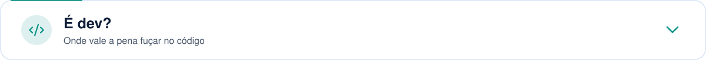

<!-- README de perfil do Jefferson Silva. Os SVGs em assets/ são gerados por gerar_assets.py: edite as listas no topo do script e rode "python gerar_assets.py". -->

<picture>
  <source media="(prefers-color-scheme: dark)" srcset="./assets/hero-dark.svg" />
  
</picture>

 
 

 
 

<a href="#trilha">Quem é você?</a> &nbsp;·&nbsp;
<a href="#whoami">whoami</a> &nbsp;·&nbsp;
<a href="#projetos">Projetos</a> &nbsp;·&nbsp;
<a href="#stack">Stack</a> &nbsp;·&nbsp;
<a href="#atividade">Atividade</a>

 

## Quem é você?

<picture><source media="(prefers-color-scheme: dark)" srcset="./assets/trilha-recrutador-dark.svg" /></picture>

 

Oi! Sou o Jeff, dev full stack aqui de São Paulo. Gosto de pegar o projeto do começo ao fim: banco, API, tela e deploy. Me formei técnico em Desenvolvimento de Sistemas e agora tô no ADS.

Se der tempo de olhar uma coisa só, olha o [**Chega Junto**](https://github.com/jeffsilva03/Chega-Junto---Desafio-IA). É um app em Flutter, com backend em FastAPI, que ajuda o paciente a se preparar pra consulta. A IA organiza o relato, mas quem revisa é sempre uma pessoa. Tem até [APK pra instalar](https://github.com/jeffsilva03/Chega-Junto-Android) e testar.

Depois dele, o [Agenda Jeff](https://github.com/jeffsilva03/agendajeff-public) (Next.js + Supabase, com testes) e o [APIClassroom](https://github.com/jeffsilva03/APIClassroom), que conecta o Google Classroom ao ChatGPT, mostram bem como eu trabalho.

Bora conversar? Me chama no [LinkedIn](https://www.linkedin.com/in/jefferson-silva-355620323/) ou manda um [e-mail](mailto:jeffop801@gmail.com).

<picture><source media="(prefers-color-scheme: dark)" srcset="./assets/trilha-cliente-dark.svg" /></picture>

 

Faço app, site, sistema e automação. Algumas coisas que já saíram daqui:

- um [sistema de rastreio de encomendas](https://github.com/jeffsilva03/Trackr), com painel pra equipe e página pro cliente consultar o pedido
- um [gerador de slides](https://github.com/jeffsilva03/slidesNSPAZ-public) que monta sozinho as apresentações litúrgicas em PowerPoint
- um [app de saúde com IA](https://github.com/jeffsilva03/Chega-Junto---Desafio-IA) pra Android

Tem uma ideia, mesmo que ainda meio bagunçada? Me [manda um e-mail](mailto:jeffop801@gmail.com) contando. Dá pra ver mais trabalhos no [portfólio](https://devjeffsilva.com.br).

<picture><source media="(prefers-color-scheme: dark)" srcset="./assets/trilha-dev-dark.svg" /></picture>

 

Então você vai curtir fuçar nesses:

- **[Agenda Jeff](https://github.com/jeffsilva03/agendajeff-public):** as regras de negócio ficam num motor em TypeScript (`supabase/functions/_shared/motor/`), e o mesmo código roda na interface, nas Edge Functions e no servidor MCP. O RLS tá nas migrations.
- **[OS-SmarTV](https://github.com/jeffsilva03/OS-SmarTV):** um launcher em Kotlin pra uma TV TCL com Android TV 9. Medi tudo na TV de verdade: abre em uns 1,5 s e, parado, não gasta CPU. Tá no `docs/PERFORMANCE.md`.
- **[APIClassroom](https://github.com/jeffsilva03/APIClassroom):** um servidor MCP que deixa o ChatGPT consultar minhas disciplinas, materiais e prazos do Classroom, só leitura.

Viu algo estranho? Abre uma issue, de verdade.

<picture><source media="(prefers-color-scheme: dark)" srcset="./assets/trilha-curioso-dark.svg" /></picture>

 

Então entra no [meu portfólio](https://devjeffsilva.com.br) e digita `jeff` em qualquer lugar da página. Ou tenta o código Konami: <kbd>↑</kbd><kbd>↑</kbd><kbd>↓</kbd><kbd>↓</kbd><kbd>←</kbd><kbd>→</kbd><kbd>←</kbd><kbd>→</kbd><kbd>B</kbd><kbd>A</kbd>.

Se quiser perder uns minutos, aperta <kbd>Ctrl</kbd> + <kbd>K</kbd> e procura "jogar". Tem um joguinho de caçar bugs escondido lá.

Ah, e abre o console do navegador. Deixei um recado pra quem é curioso.

## whoami

<picture>
  <source media="(prefers-color-scheme: dark)" srcset="./assets/terminal-dark.svg" />
  
</picture>

## Projetos em destaque

Clique em um card para abrir o repositório.

<a href="https://github.com/jeffsilva03/Chega-Junto---Desafio-IA"><picture><source media="(prefers-color-scheme: dark)" srcset="./assets/card-chega-junto-dark.svg" /></picture></a>
<a href="https://github.com/jeffsilva03/agendajeff-public"><picture><source media="(prefers-color-scheme: dark)" srcset="./assets/card-agenda-jeff-dark.svg" /></picture></a>
<a href="https://github.com/jeffsilva03/APIClassroom"><picture><source media="(prefers-color-scheme: dark)" srcset="./assets/card-apiclassroom-dark.svg" /></picture></a>
<a href="https://github.com/jeffsilva03/slidesNSPAZ-public"><picture><source media="(prefers-color-scheme: dark)" srcset="./assets/card-slides-nspaz-dark.svg" /></picture></a>

 

## Stack

<picture>
  <source media="(prefers-color-scheme: dark)" srcset="./assets/stack-dark.svg" />
  
</picture>

## Atividade

<picture>
  <source media="(prefers-color-scheme: dark)" srcset="https://raw.githubusercontent.com/jeffsilva03/jeffsilva03/output/snake-dark.svg" />
  
</picture>

 

<!-- A instância pública do github-readme-stats sofre limite de uso. Se não carregar, faça deploy próprio na Vercel e troque a URL. -->
<picture>
  <source media="(prefers-color-scheme: dark)" srcset="https://github-readme-stats.vercel.app/api?username=jeffsilva03&show_icons=true&hide_border=true&count_private=true&bg_color=0B1426&title_color=5DB7FF&text_color=E8F1FD&icon_color=2379E8" />
  
</picture>
<picture>
  <source media="(prefers-color-scheme: dark)" srcset="https://github-readme-stats.vercel.app/api/top-langs/?username=jeffsilva03&layout=compact&hide_border=true&bg_color=0B1426&title_color=5DB7FF&text_color=E8F1FD" />
  
</picture>

 

<a href="https://devjeffsilva.com.br">
<picture>
  <source media="(prefers-color-scheme: dark)" srcset="./assets/footer-dark.svg" />
  
</picture>
</a>

 

<a href="https://devjeffsilva.com.br">Portfólio</a> &nbsp;·&nbsp;
<a href="https://devjeffsilva.com.br/all_projects">Projetos</a> &nbsp;·&nbsp;
<a href="https://www.linkedin.com/in/jefferson-silva-355620323/">LinkedIn</a> &nbsp;·&nbsp;
<a href="https://github.com/jeffsilva03?tab=repositories">GitHub</a> &nbsp;·&nbsp;
<a href="mailto:jeffop801@gmail.com">E-mail</a> &nbsp;·&nbsp;
<a href="#topo">Voltar ao topo ↑</a>

